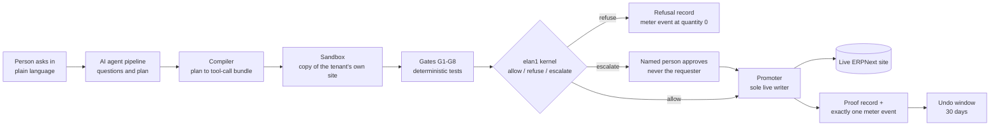
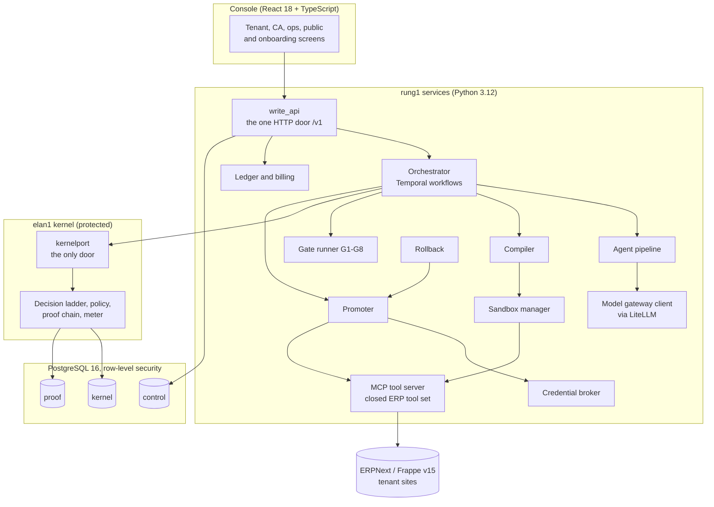

# Architecture

A description of how rung1 is put together. Status words are used precisely: **built** means merged into `main` at a
stage close; **in progress** means on an open stage branch; **planned** means not started.

## 1. The governed change, end to end

What each step is for:

| Step | Purpose | Where it stands |
|---|---|---|
| Ask and plan | An agent pipeline captures the request, asks questions, classifies it and produces a typed plan. The model can only propose a write intent. | Built (S7) |
| Compile | Deterministic code turns the validated plan into an ordered bundle of tool calls, a manifest and a diff. | Built (S8) |
| Sandbox | The bundle is applied to a clone of the tenant's own site, made by backup and restore; the clone never shares a writable store with live. | Built (S8) |
| Gates | Deterministic checks over the sandbox result, for example the ledger still balances and no filed GST period is touched. A missing result counts as a fail. | Built (S9) |
| Decide | The kernel walks an ordered ladder of checks ("rungs") and answers allow, refuse or escalate. No model client can be imported here. | Built (S2); joined to the live write path in S10, in progress |
| Approve | A named human with the right role approves, after a step-up check; the approver can never be the requester. | In progress (S10) |
| Promote | The promoter takes a site lock, checks the bundle digest against what was tested, obtains a single-use token from the credential broker and writes. | In progress (S10) |
| Prove and meter | Every outcome writes one proof record in a hash-linked chain and exactly one meter event; refusals are metered at zero. | Kernel side built (S2); billing side built (S12) |
| Undo | A fast path restores the pre-change snapshot; a forward path publishes a reversing change built only from stored inverses. | In progress (S11) |

## 2. Components

Design points worth noting:

- **One door into the kernel.** Code above the kernel may import only the kernel's port package; every other kernel
  module is forbidden by an import-linter contract checked in CI.
- **One writer into a live site.** Only the promoter can obtain a live-site token, and rollback goes through the
  promoter rather than holding a credential of its own.
- **Three databases.** Control (tenants, runs, plans, billing), kernel (decisions, meter events, obligations) and proof
  (the record chain). On `main`, 41 of 45 tables have row-level security enabled and forced, 50 policies exist, 27
  tables are insert-only by grant, and no non-superuser role can bypass row-level security (measured from the
  PostgreSQL catalogue).
- **Contracts first.** Shared shapes are Pydantic models exported as JSON Schema and generated into the TypeScript
  client, so the console and the API cannot drift apart silently. Error and refusal codes come from one frozen
  register of 142 codes.
- **Durable workflow.** A Temporal workflow drives each change from budget hold to settlement; every step is
  idempotent, approval waits are durable signals with an expiry, and a kernel outage parks the run rather than
  failing it.

## 3. The twelve safety invariants, in plain words

Each invariant is enforced by code (an import contract, a database constraint, a grant check or a test), not by a
sentence in a document.

| # | In plain words | How it is held |
|---|---|---|
| I1 | An AI model can suggest a change but can never be the thing that allows it. | Import rules stop the gates, compiler, promoter, rollback, credential broker and the kernel's deciding steps from loading any model client. |
| I2 | Only one component can write to a customer's live site. | Only the promoter can obtain a live-site token; CI checks credential scope. |
| I3 | Nothing outside the kernel reaches into its internals. | An allow-list import contract: only the kernel's port is importable. |
| I4 | Every outcome leaves a record and exactly one meter event; refusals cost nothing. | Database constraints: a refusal must have quantity zero; one event per intent. |
| I5 | Proof and audit logs can only be added to, never edited or deleted. | No update or delete grants; a CI grant check. |
| I6 | One business can never see another's data. | Tenant id required on every control table, row-level security, no bypass role, a cross-tenant read test. |
| I7 | A failed gate means there is no way to approve; the GST filed-period gate can never be overridden; a missing gate result is a fail. | Gate engine and kernel, with seeded-violation tests. |
| I8 | Undo is never written by an AI model. | Reversals are assembled only from what the ERP tools returned. |
| I9 | What was tested is exactly what goes live. | Sandbox and live receive identical bundle bytes, compared by digest. |
| I10 | Who you are and which business you act for come from your sign-in token, never from what you send. | An API dependency, tested with forged request fields. |
| I11 | The person who approves can never be the person who asked. | A kernel obligation check and an API check. |
| I12 | No overclaiming about the strength of records at this level of assurance. | A copy lint over API messages and the console that bans words such as "tamper-proof" or "court-ready" as claims. |

## 4. Technology stack

| Layer | Technology | Status |
|---|---|---|
| Console | React 18, TypeScript, Vite; tenant, CA, ops, public and onboarding screens (124 screens, 127 routes) | Built; wired to the API stage by stage |
| API | Python 3.12, FastAPI, Pydantic v2; JSON over `/v1` with bearer tokens | Built (89 `/v1` routes on `main`; 157 with the open stages) |
| Contracts | Pydantic models to JSON Schema 2020-12 to a generated TypeScript client | Built |
| Database | PostgreSQL 16 with row-level security; Alembic migrations across three stores | Built |
| Workflow | Temporal (one namespace per tenant) | Built (local dev server) |
| ERP | ERPNext and Frappe version 15, run on an Ubuntu 24.04 bench for development; a synthetic reference tenant | Built for development |
| ERP tools | An MCP-over-HTTP tool server, one per site, with a closed set of 20 read and write tools | Built |
| Models | A model gateway client with six aliases through LiteLLM; one cost event per model call | Built |
| Secrets | OpenBao behind a credential broker that issues short-lived, single-use tokens | In progress (S10) |
| Identity | Locally issued tokens in development; Keycloak (tenant realm and a separate staff realm with MFA) at deployment | Keycloak-ready; production sign-in planned (D6) |
| Object store | An adapter over a local folder today, S3-compatible later | Built (local) |
| Hosting | AWS Mumbai region | Planned (D1–D12, not started) |

## 5. What this page does not claim

The governed write path is not yet joined end to end on `main`: the conformance audit of 7 Oct 2026 recorded that
several workflow steps were still stubs or test fakes and that the first real governed write belongs to stage S10,
which is in progress. Nothing here runs in production.
