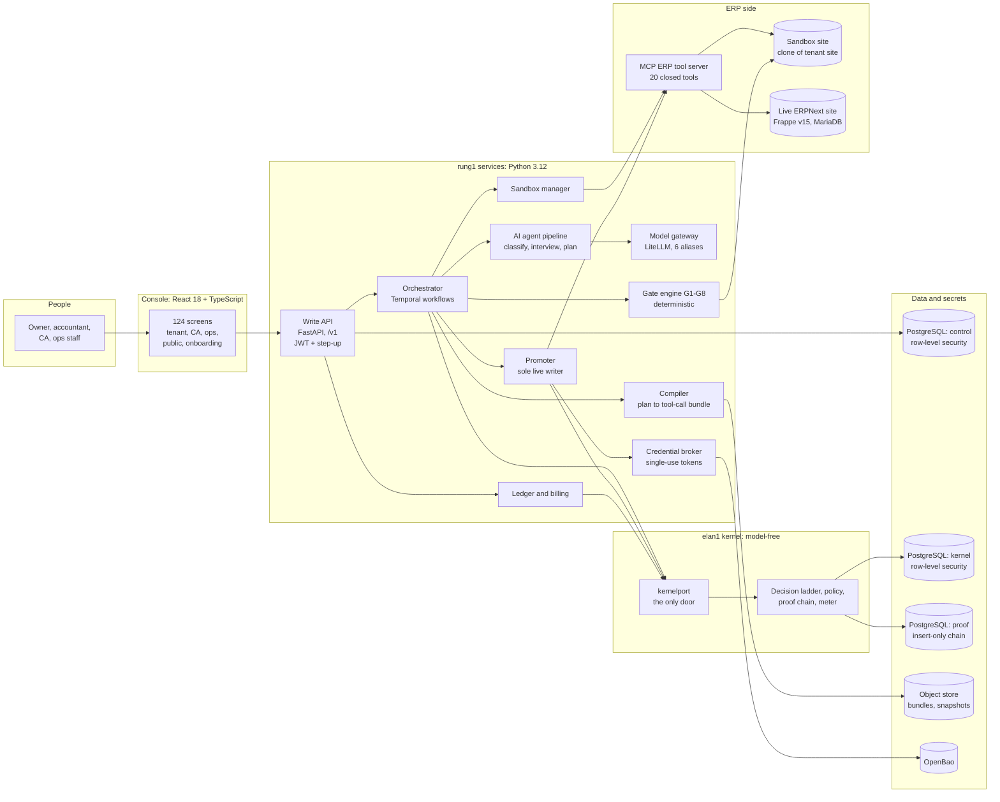
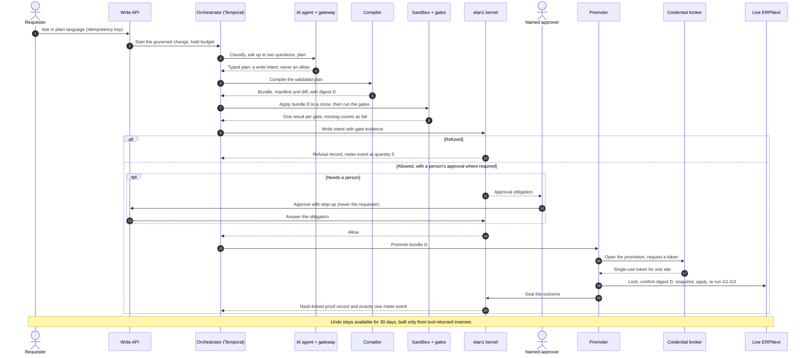

# rung1: governed AI changes to a business's live ERP

**rung1 lets a business owner ask for a change to their accounting and operations system in plain language, and
lets AI build it, while only deterministic code and a named human can let that change touch the company's books.**

A product of elan1, built for Indian businesses that run on ERPNext: an agent layer over a system of record, where
every write is tested in a sandbox, decided by a model-free kernel, approved by a person who is not the requester,
published by a single writer, proven by a hash-linked record, metered exactly once and undoable for 30 days.

This repository is the owner's portfolio record of that work. It holds documents only: no source code, no secrets and
no customer data. Every number on this page was measured on 13 Oct 2026 from the project's git history, its PostgreSQL
catalogue and its generated inventory report; none is estimated.

---

## Built by one engineer, directing a team of AI agents

I took rung1 end to end on my own: the product idea and positioning, the product and screen design, the 105-step
build plan, the architecture, all twelve architecture decision records, and every ruling and approval along the way.

**I did not hand-write the code.** A team of AI agents (Claude Code) wrote it, under rules I wrote and machines
enforced: hooks that block an agent from touching safety-critical folders until I accept the governing decision
record, CI checks that fail the build when an invariant is broken, a separate read-only reviewer agent that attacks
every unit, and audits that check the whole build against the plan. My work was that of a founding engineer and
architect: decide what to build, decide how it must be safe, split it into units small enough to verify, run the
agents, and refuse anything that could not be proven.

The method in full: [AGENTIC-AI-METHOD.md](AGENTIC-AI-METHOD.md).

---

## Headline numbers (measured 13 Oct 2026)

| 1,75,033 | 157 | 92 | 60 | 1,293 | 247 |
|:---:|:---:|:---:|:---:|:---:|:---:|
| lines of code | `/v1` API routes | database tables | database migrations | commits | test files |

| 148 of 202 | 12 of 18 | 12 | 142 | 20 | 124 |
|:---:|:---:|:---:|:---:|:---:|:---:|
| build units done (73%) | build stages closed | architecture decision records | frozen error and refusal codes | ERP tools (MCP) | console screens |

- Lines of code use Indian digit grouping: 1,75,033 is 175,033 (about 1.75 lakh). That is 1,36,758 merged on `main`
  plus 38,275 net in the six open stages, counted once. It covers source, tests and the generated client only; the
  60,338 lines of Markdown documentation are not counted.
- Routes, tables, migrations, commits and test files also combine `main` with the open stages, each item counted once.
  On `main` alone: 89 routes, 45 tables, 33 migrations, 856 commits, 186 test files.
- First commit 26 Sep 2026. Largest full test run at a stage close: 2,932 passed (S12 close, 6 Oct 2026).

Every figure, with "done" and "still to do" side by side: [BY-THE-NUMBERS.md](BY-THE-NUMBERS.md).

---

## The problem

Small and mid-sized Indian businesses run their books, stock, GST and payroll on ERP systems such as ERPNext.
Changing those systems (a new field, a report, a workflow rule, a print format) needs a consultant, takes days and is
risky: one careless change can unbalance the ledger, touch a GST period that has already been filed, or break the
statutory audit trail.

AI can now write those changes in seconds. That makes the problem sharper, not smaller. A language model can be
wrong, can be steered by text hidden in a customer note or an uploaded file, and cannot be held accountable. No
business should let a model write directly into its books.

The question rung1 answers: **how do you let AI do the work on a company's system of record, while making it
impossible for AI to be the thing that says yes?**

## What rung1 does

```text
ask -> plan -> sandbox -> gates -> kernel decides -> named human approves -> promoter publishes -> proof + meter -> 30-day undo
```

1. **Ask.** A person asks for a change in plain language.
2. **Plan.** An AI agent pipeline classifies the request, asks at most two clarifying questions and produces a typed,
   validated plan. The model can only propose a write intent.
3. **Sandbox.** Deterministic code compiles the plan into an ordered bundle of ERP tool calls and applies it to a
   clone of the business's own site, never the live one.
4. **Gates.** Deterministic gates test the result: the ledger still balances, stock still reconciles, permissions
   changed only as declared, no filed GST period is touched, the statutory audit trail is intact. A missing result is
   a fail.
5. **The kernel decides.** The elan1 kernel, into which no model client can be imported, walks an ordered ladder of
   checks and answers allow, refuse or escalate. A refusal is a normal answer with a code, the rule that fired and
   what would change it.
6. **A named human approves**, after a fresh step-up check, and that person can never be the one who asked.
7. **The promoter publishes** the exact bytes that were tested to the live site. It is the only component that can
   obtain a live-site credential, and that credential works once.
8. **Proof and meter.** Every outcome, refusals included, writes one record in a hash-linked chain and exactly one
   meter event. Refusals are metered at zero.
9. **Undo for 30 days**, assembled only from what the ERP tools themselves returned, never written by a model.

---

## End to end: idea, plan, design, build, deploy

| # | Phase | What I produced | Status |
|---|---|---|---|
| 1 | **Idea and positioning** | The product thesis (a governed agent layer over a business's system of record, with a separate model-free trust kernel), the target market and the product lines: the core platform, then attach mode and Tally migration, CRM and voice, and commerce. Written up as an information memorandum, a technology memorandum, a technical manifest, a financial model and a brand book. | Done |
| 2 | **Plan** | A phase-by-phase plan of **105 ordered steps** across **18 build stages**, a production deployment stage and three later phases: **202 units** in all. Twelve safety invariants, each paired with the check that enforces it. A register of resolved decisions that overrides earlier text, a prompt library for the agents and a wave plan for running units in parallel. | Done |
| 3 | **Architecture** | An architecture atlas; **12 architecture decision records**, each opening with its failure cases before its normal behaviour, each attacked by an independent reviewer and accepted by me; one frozen register of **142** error and refusal codes; contracts defined once in Pydantic and generated into the console's TypeScript client. | Done |
| 4 | **Product and screen design** | A design concept note and a design system with a component library; then the whole console on mock data first: **124 screens** over **127 routes** for tenants, chartered accountants, operations staff, the public site and onboarding. Screens are switched from mock data to the live API stage by stage. | Screens done; 7 of 15 service areas live on `main`, more on the open stages |
| 5 | **Build** | The backend as a Python 3.12 workspace: the write API, the Temporal orchestrator, the AI agent pipeline and model gateway, the compiler, the sandbox manager, the gate engine, the elan1 kernel, the MCP tool server for ERPNext, the ledger and billing; and, on the open stages, the promoter, credential broker, rollback, assurance, CA, WhatsApp, operations and onboarding services. | **12 of 18 stages closed; 148 of 202 units done** |
| 6 | **Verify and audit** | A failing test or seeded violation before every implementation; **149** independent unit reviews; **13** stage path audits; a **13-auditor** conformance audit of the whole build (7 Oct 2026) and the fix units that followed. | Ongoing with every unit |
| 7 | **Deploy** | A twelve-unit deployment plan (D1 to D12) for AWS Mumbai: container images, CI/CD, infrastructure, production databases, Keycloak sign-in, ERPNext hosting pools, monitoring, Temporal on the cluster, secrets and keys, the sandbox pool, backups and disaster recovery, and a security review before go-live. | **Planned, not started** |

---

## Architecture

### Components



Three rules shape the picture. **The kernel has one door**: code above it may import only `kernelport`, enforced by
an import contract in CI. **The live site has one writer**: only the promoter can obtain a live credential, and
rollback goes through the promoter instead of holding its own. **No model below the planning line**: the gates,
compiler, promoter, credential broker, rollback and the kernel's deciding rungs cannot load a model client at all.

More detail, including the twelve invariants in plain words: [ARCHITECTURE.md](ARCHITECTURE.md).

### One governed change



An honest note on where this stands: the stages up to the gates, and the kernel itself, are built and merged into
`main`. Approval, the promoter, the credential broker and the seal are built on the open S10 branch, where the whole
path is being joined into the first end-to-end governed write.

---

## Why this is hard

1. **AI may propose but never approve.** The model's output is typed as a write intent and nothing more. Every
   component that can say yes is barred from importing a model client by an import contract checked in CI, and a
   seeded violation proves the check fails when the rule is broken.
2. **One writer to the live site.** Only the promoter can obtain a live credential, from a credential broker backed
   by OpenBao, as a short-lived token that works once and for one site. A nine-step protocol (lock, digest check,
   write stop, snapshot, apply, re-gate, restore on failure, release, seal) has a written answer for every failure.
3. **Proof and metering that add up.** Every outcome writes one record in a hash-linked chain that can be re-verified
   by recomputing every digest, and exactly one meter event. Database constraints make a second event for the same
   intent, or a charged refusal, impossible; a nightly two-way reconcile blocks invoicing on any break.
4. **Tenant isolation in the database, not only in the code.** Every tenant table carries a required tenant id and
   row-level security that is enabled and forced (41 of 45 tables on `main`, 50 policies). No application role can
   bypass it, and CI runs a cross-tenant read test and checks every migration.
5. **Tenant and actor come from the token.** Who you are and which business you act for are never read from the
   request body; a test sends forged fields to prove it.
6. **What was tested is exactly what goes live.** The sandbox and the live site receive byte-identical bundles,
   compared by digest at promotion.
7. **Deterministic gates where silence is failure.** Gate code has no clock, randomness, environment reads or model
   client. A missing gate result is a fail, a blocked gate leaves no path to approval, and neither the statutory
   audit-trail gate nor the filed-GST-period check can ever be overridden.
8. **Undo that cannot be hallucinated.** Every ERP write tool returns its own inverse; the undo set is assembled only
   from those returns and checked against stored digests. A change marked not reversible goes to a person.
9. **Durable, replayable workflows.** Each change runs as a Temporal workflow from budget hold to settlement, with
   idempotent steps, approval waits held as durable signals with an expiry, and a kernel outage that parks the run
   instead of failing it.
10. **Records that can only grow.** Proof, audit and meter tables are insert-only by grant (27 tables on `main`), and a
    CI grant check fails the build if any role gains update or delete.
11. **Governing the AI agents that built it.** The same discipline applies to the builders: protected-path hooks stop
    an agent writing to the kernel, promoter, credential broker, rollback or the harness until I accept the governing
    decision record, and no agent can set that acceptance line.

---

## Technology stack

| Layer | Technology | Status |
|---|---|---|
| Console | React 18, TypeScript 5, Vite 5, React Router; own design system and component library; TypeScript API client generated from the backend contracts | Built: 124 screens, 127 routes; wired to the API stage by stage |
| API | Python 3.12, FastAPI, Pydantic v2; JSON over `/v1`; JWT bearer tokens with step-up for sensitive actions; idempotency keys; problem-details errors with registered codes | Built: 89 routes on `main`, 157 with the open stages |
| Contracts | Pydantic models exported as JSON Schema 2020-12 and generated into TypeScript; one frozen register of 142 codes | Built |
| Data | PostgreSQL 16 in three databases (control, kernel, proof) with row-level security; SQLAlchemy 2 and psycopg 3; Alembic migrations | Built: 92 tables and 60 migrations with the open stages |
| Workflow | Temporal: one namespace per tenant, durable signals, idempotent activities | Built: 4 workflows, 29 activities on `main` |
| ERP | ERPNext and Frappe v15 on MariaDB, on an Ubuntu 24.04 bench under WSL; a custom Frappe app; a synthetic reference tenant for tests | Built for development |
| ERP tools | An MCP-over-HTTP tool server per site with a closed set of 20 read and write tools, each write returning its inverse | Built |
| AI | LiteLLM model gateway with six model aliases and one cost event per call; versioned prompts; an evaluation set with prompt-injection evals; Groq-hosted open models today, Claude planned as a configuration switch | Built on Groq; Claude planned |
| Security | OpenBao behind the credential broker; JWT step-up; import-linter invariant contracts; row-level security and grant checks in CI; claim lint; gitleaks secret scanning in a pre-push hook | Built, except the broker on OpenBao (in progress, S10) |
| Local services | Docker Compose for PostgreSQL, Temporal, OpenBao, Valkey, the model gateway and an S3-compatible object store | Built for development |
| Tooling | uv workspace, ruff, pyright, pytest (with live ERPNext, Temporal and gateway suites), `tsc` and Vite builds, git hooks | Built |
| Build method | Claude Code agents with hooks, read-only reviewer and path-auditor subagents, scripted parallel workflows | In use throughout |
| Production | AWS Mumbai region, container images, CI/CD, Keycloak (a tenant realm and a separate staff realm with MFA), monitoring, backups and disaster recovery | **Planned** (D1 to D12, not started) |

---

## How it was built

Full account: [AGENTIC-AI-METHOD.md](AGENTIC-AI-METHOD.md). In short:

- **Parallel agents from a dependency graph.** 202 units ordered into 105 steps; workflow scripts start a unit only
  when its dependencies are merged, with up to eight agents at once, each on its own branch and worktree.
- **Writer and reviewer are never the same agent.** A separate read-only agent attacks every unit and writes a review
  case (149 so far); a rejected unit goes back to its writer before it can merge.
- **Rules a machine enforces.** Hooks, protected paths, seven invariant check modules and 45 seeded violations that
  prove each check can fail. A rule that lives only in prose is treated as a rule that will be broken.
- **Audits beyond the tests.** Every stage close has a path audit for bypasses; a 13-auditor conformance audit found
  that a fully green suite still hid stubs, and the fixes were built, reviewed and merged.
- **Evidence over assertion.** Every "done when" line is reported as passed, failed or not measurable, with the
  command and its output; a skipped test counts as not done; anything that installs or provisions is run for real.
- **Memory that stops repeat mistakes.** The lead session keeps persistent memory of rules learned from real
  failures, my rulings and my approvals. The failures themselves are in [LESSONS.md](LESSONS.md).

---

## Status

> **Status, 13 Oct 2026**
>
> **148 of 202 units (73%), 60 of 105 steps, 12 of 18 stages closed** (S0 to S9, S12, S14).
>
> **In progress:** S10 (the first live governed write, and the credential broker on OpenBao), S11, S13, S15, S16 and
> S17, with 11 units and six stage closes still open across them.
>
> **Not started:** production deployment on AWS Mumbai (D1 to D12) and the later product lines (P2 attach mode and
> Tally, P3 CRM and voice, P4 commerce).
>
> This page will say "in production" only when that is true.

What remains, in order: [ROADMAP.md](ROADMAP.md).

## Explore this repository

| Page | What it covers |
|---|---|
| [ARCHITECTURE.md](ARCHITECTURE.md) | The flow, the components, the twelve safety invariants and the stack |
| [AGENTIC-AI-METHOD.md](AGENTIC-AI-METHOD.md) | How a team of AI agents was planned, run, reviewed and audited |
| [DECISIONS.md](DECISIONS.md) | The twelve architecture decision records and my rulings, in plain words |
| [BUILD-LOG.md](BUILD-LOG.md) | Dated timeline and one row per stage: dates, units, tests, audit verdict |
| [BY-THE-NUMBERS.md](BY-THE-NUMBERS.md) | Every measured figure, done and still to do |
| [LESSONS.md](LESSONS.md) | Real problems met during the build and how each was solved |
| [ROADMAP.md](ROADMAP.md) | What is not done yet, in order |
| [screenshots/README.md](screenshots/README.md) | Console screens to capture |

## Confidentiality

rung1 is elan1's product. This repository describes the owner's work on it and contains no code, no secrets, no
pricing and no customer data. The plan documents, prompt library, business documents and source code remain private
to elan1.
